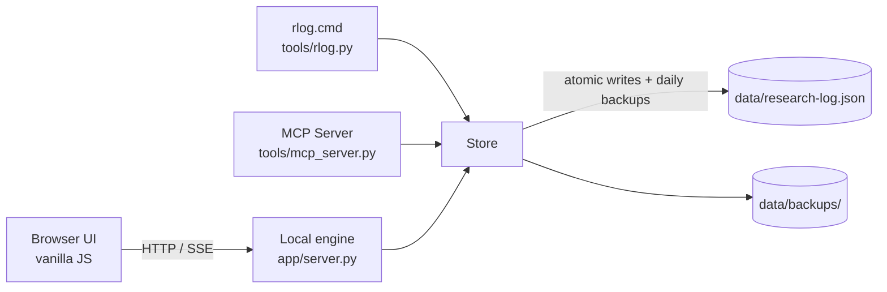

# ResearchLog

[中文](README.md) | English

> **A local-first, AI-native research project and progress manager.**
> Users manage goals and progress on a board; agents read and write the same research memory through MCP.

[](LICENSE)
[](https://www.python.org/)
[](#quick-start)
[](#design-trade-offs)


---

## Why ResearchLog

Research progress is usually scattered across chat logs, paper notes, dozens of folders, and memory. Before a group meeting or when writing a paper, the most time-consuming part is **recalling what you actually did this week**.

Generic note and todo tools can record existing projects, but they lack the research structure of "project → main goal → milestones → progress → papers." More importantly, in the age of AI, they cannot let an AI safely read and write your research context.

ResearchLog aims to make this small, local, and usable by AI agents:

- **One main goal per project**, with milestones you can freely add, delete, check, and reorder by dragging;
- **A progress log** recorded by time, easy to review, and convertible into a weekly report in one click;
- **Papers / repositories / notes** attached to projects; only paths are stored, files are never copied, and one click jumps to them;
- **MCP** exposes this data to Codex, Claude, and other agents — say one sentence, and goals and progress are updated;
- **Bilingual UI**: switch in the top-right corner; only the UI is translated, never your data;
- **Data is a readable JSON file**, offline, account-free, easy to back up and carry.

---

## Features

### Projects and goals

- Three statuses: **planned / active / done**, as three board columns; cards can be dragged;
- Each project has a **main goal**, **success criteria**, and **target date**;
- Milestones can be checked, given due dates and notes, and **reordered by dragging**;
- The project list on the left filters by status and shows a completion bar;
- The top search box (`Ctrl F`) searches projects, goals, and milestones at once;
- Completion time is recorded automatically; progress and the board update immediately.

### Papers, repositories, and notes

The "Resources & repositories" section in a project has three categories, each with multiple entries:

| Type | Use | Opens with |
|---|---|---|
| **Papers** | PDF papers, reference folders | System default reader / Explorer |
| **Repositories** | Code, data, and computation directories | Explorer at the project root |
| **Notes** | Markdown progress, derivations, meeting notes | Built-in reader |

- Three ways to add: "Drop folder / file", "Choose folder", and "Choose file"; the drop flow uses a small native window because browsers cannot read local paths;
- **Only absolute paths are stored; files are never copied**; if a file moves, re-attach it;
- Every chip has "Show in folder".

### Built-in Markdown + formula reader

Click a note to read it in the window, without opening an external app:

- Headings, lists, task lists, tables, code blocks, quotes, and links;
- Inline `$...$` and block `$$...$$` formulas render with native browser **MathML**: fractions, scripts, roots, sums/integrals, matrices, Greek letters;
- Shows the file path and update time, with "Show in folder";
- Close with `Esc` or by clicking the backdrop;
- Fully offline, no KaTeX, no extra dependencies.

> Typical use: write weekly progress, derivation drafts, or experiment notes as `progress.md`, attach it as a project note, and later open a fully typeset document.

### Progress log and weekly review

- The right-hand log records entries by time, filters by project, and copies one entry or the whole list;
- The **Week** view aggregates **overdue / today / next 7 days / completed this week / progress this week / stale projects**;
- Click any row to jump to the project and highlight the milestone;
- "Copy review" generates a Markdown weekly report in one click.

### MCP: a research memory for agents

`tools/mcp_server.py` is a stdio MCP server that shares the same `Store` as the GUI and CLI:

- Protocol: JSON-RPC 2.0, one message per line; stdout carries protocol messages only, logs go to stderr;
- Clients: Codex, Claude Desktop, Cursor, and other MCP-capable tools;
- Security boundary: **communication is local process-to-process over stdio**, with no port and no network;
- Writes are equivalent to the GUI: atomic writes, daily backups, `rev` increments, and the window refreshes within about one second.

The 12 exposed tools:

| Tool | Purpose |
|---|---|
| `log_list` | List projects (filterable by status) |
| `log_show` | Show project details, goals, and recent progress |
| `log_create_project` | Create a project |
| `log_add_milestone` | Add a milestone |
| `log_check_milestone` | Check or uncheck a milestone |
| `log_delete_milestone` | Delete a milestone |
| `log_add_note` | Record a progress entry |
| `log_set_status` | Change project status |
| `log_set_goal` | Update the main goal / criteria / target date |
| `log_rename_project` | Rename a project |
| `log_export` | Export Markdown / JSON |
| `log_delete_project` | Delete a project (dangerous; explicit confirmation required) |

Configuration: [docs/en/mcp.md](docs/en/mcp.md). Once connected, you can say:

> "Open the Protein folding project, record today's baseline verification, and check off the corresponding milestone."

The agent calls `log_show` → `log_add_note` → `log_check_milestone`, and the progress bar in the UI updates.

### CLI: the same data, scriptable

`rlog.cmd` reuses the same `Store` and is suitable for batch jobs, Git hooks, or other agents:

```bat
rlog.cmd list
rlog.cmd add "Protein folding" "Reproduce the baseline" --due 2026-12-01
rlog.cmd done "Protein folding" "Reproduce the baseline"
rlog.cmd note "Tuned the simplified model today" --project "Protein folding"
rlog.cmd export md --out weekly.md
rlog.cmd where
```

- Supports `--json` (anywhere on the command line) and `--data <dir>`;
- Full command reference: [docs/en/cli.md](docs/en/cli.md).

### Local-first and data safety

- Data is **one plain JSON file**: `data/research-log.json`;
- Atomic writes (temporary file + replace), with an automatic backup before the first change of each day, kept for 14 days;
- File watcher + SSE: changes from the CLI or MCP refresh an open window within about one second;
- No cloud, no account, no telemetry; resources store paths only and never move files;
- Import / export JSON; export Markdown project reports and weekly reviews;
- Moving to another machine is just copying the directory; data travels with the app.

### Interface

- **EN / 中文** toggle in the top-right corner; follows the browser language by default;
- Only UI copy is translated: **project names, notes, and log content stay as written** and are never machine-translated;
- Vanilla JavaScript + CSS, no frontend build step;
- Light / dark theme follows the system;
- Keyboard accessible (`Ctrl F` to search, `Esc` to close dialogs and the reader).

---

## Quick start

### Requirements

- Windows 10 / 11;
- Python **3.12+** (when running from source);
- Edge or another Chromium browser (for the app window; falls back to the default browser if Edge is unavailable).

> No third-party Python packages are required; the runtime has zero dependencies.

### Option 1: Download a Release

1. Download the latest `ResearchLog-<version>-win64.zip` from [Releases](https://github.com/Harmonicoscillator101/research-log/releases/latest);
2. Extract it to any directory (avoid special characters in the path);
3. Double-click `科研日志.exe`, or run `run.cmd`.

> **Unsigned build warning**: `科研日志.exe` and `添加资料.exe` are not code-signed. Windows SmartScreen / Defender may show “Windows protected your PC” or “Unknown publisher”. This is a common warning for unsigned builds and does not mean malware was detected. Choose **More info → Run anyway**, verify the SHA-256 checksum published on the Release page, or run from source with `run.cmd`. Do not disable Windows Defender just to run the app.
>
> Verify with: `Get-FileHash .\ResearchLog-0.1.0-win64.zip -Algorithm SHA256`

### Option 2: Run from source

```bat
git clone https://github.com/Harmonicoscillator101/research-log.git
cd research-log
run.cmd
```

`run.cmd` tries `runtime\python\python.exe`, then `py -3`, then `python`, and starts the local engine and window.

You can also start the engine only and use a browser:

```bat
python app\server.py
:: open http://127.0.0.1:47823/
```

### Layout

```
research-log/
├─ app/
│  ├─ server.py          # local HTTP engine: static files, REST, SSE, resource open
│  └─ web/               # vanilla frontend: index.html / app.js / styles.css / markdown.js
├─ tools/
│  ├─ rlog.py            # CLI and Store (atomic writes, backups, lock)
│  └─ mcp_server.py      # MCP stdio server
├─ build/                # optional C# sources for the two native helpers
├─ docs/                 # architecture, data format, MCP, CLI, FAQ, build
├─ examples/demo-data/   # fictional sample data
├─ launch.py             # launcher: ensure engine + open the desktop window
├─ rlog.cmd              # CLI entry point
├─ run.cmd               # source launcher
└─ config.json           # data directory and port
```

---

## MCP setup

### Codex

Edit `~/.codex/config.toml`:

```toml
[mcp_servers.research_log]
command = "python"
args = ["<REPO>/tools/mcp_server.py"]
startup_timeout_sec = 30
```

If `python` is not on PATH on Windows, use `py` with `-3`:

```toml
command = "py"
args = ["-3", "<REPO>/tools/mcp_server.py"]
```

### Claude Desktop / other clients

```json
{
  "mcpServers": {
    "research-log": {
      "command": "python",
      "args": ["<REPO>/tools/mcp_server.py"]
    }
  }
}
```

Replace `<REPO>` with the absolute path to this repository and restart the client. See [docs/en/mcp.md](docs/en/mcp.md).

---

## Architecture



Design trade-offs:

- **Python standard library**: HTTP, JSON, and file watching all use stdlib; download and run, no pip;
- **JSON instead of a database**: readable, diffable, directly backup-able; personal research scale (dozens of projects, thousands of entries) is enough;
- **Paths instead of copies**: papers can be several GB, so copying is not viable; if a path breaks, the user re-attaches it;
- **One Store for three entry points**: GUI, CLI, and MCP do not implement separate write paths, avoiding inconsistent versions and backups.

More: [docs/en/architecture.md](docs/en/architecture.md) and [docs/en/data-format.md](docs/en/data-format.md).

---

## Data and privacy

- Default data directory: `data/` (relative to the program directory); change `dataDir` in `config.json` to an absolute path if needed;
- Default port: `47823`, listening on `127.0.0.1` only;
- `.gitignore` excludes `data/`, `runtime/`, `profile/`, `*.exe`, etc.; **never commit real research data**;
- `examples/demo-data/research-log.json` is fictional sample data, safe for demos and tests.

---

## Roadmap

- [x] Projects / milestones / progress log / weekly review
- [x] Papers, repositories, and notes (path references + native drop window)
- [x] Built-in Markdown + LaTeX (MathML) reader
- [x] CLI and MCP sharing the Store
- [x] Atomic writes, daily backups, file watcher + SSE
- [ ] One-click MCP client configuration
- [ ] MCP Resources / Prompts (weekly review, project summary)
- [ ] Cross-project paper library
- [ ] Reminders and calendar integration
- [ ] Automated tests and a packaging pipeline

More: [docs/en/roadmap.md](docs/en/roadmap.md).

---

## Contributing

Issues and pull requests are welcome. Before starting, read [CONTRIBUTING.md](CONTRIBUTING.md); the [Code of Conduct](CODE_OF_CONDUCT.md) applies; report security issues privately as described in [SECURITY.md](SECURITY.md).

If this project helps you, a Star is appreciated.

---

## License

[MIT](LICENSE). Copyright (c) 2026 Ziyue Wang.
