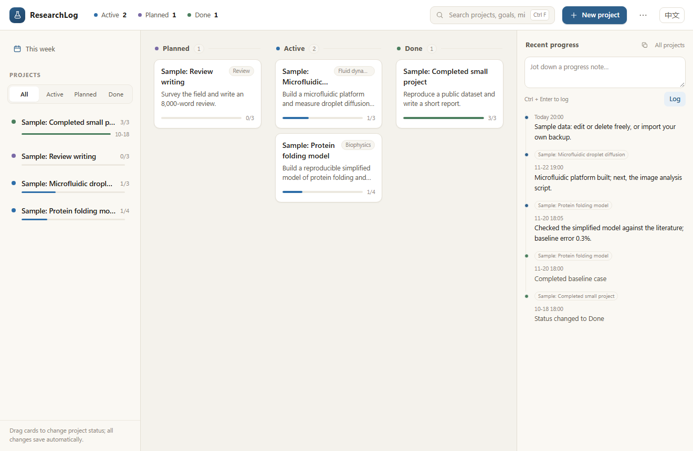

# ResearchLog

[中文](README.md) | English

> A local-first, AI-native research project and progress manager.
> Humans manage goals on a board; agents read and write the same research memory through MCP.



ResearchLog helps researchers track projects, goals, milestones and daily progress in a single local JSON file. It is designed for Windows, runs offline, and has no runtime dependencies beyond Python and a browser engine.

Use the **EN / 中文** button in the top bar to switch the interface language; it defaults to your browser language and never translates user-entered content.

## Features

- **Project board**: planned / active / done, drag cards between columns;
- **Goals and milestones**: one big goal per project, checkable sub-goals with due dates, notes, drag-and-drop ordering and progress;
- **Resource shelf**: papers, repositories and Markdown notes attached per project (path-only, no file copying);
- **Built-in Markdown + LaTeX reader**: headings, lists, tables, code, task lists, and `$...$` / `$$...$$` formulas rendered with native MathML;
- **Progress log and weekly review**: one-click Markdown weekly report;
- **Bilingual UI**: Chinese / English switch in the top bar, follows the browser language; user-entered content is never translated;
- **MCP server**: 12 tools over stdio for Codex, Claude Desktop, Cursor and other MCP clients;
- **CLI**: `rlog.cmd`, JSON output, scriptable;
- **Local-first**: atomic writes, daily backups, file watcher + SSE live refresh;
- **Export / import**: Markdown reports and JSON.

## Quick start

Windows 10/11 with Python 3.12+:

```bat
run.cmd
```

Or start the engine only and open the page manually:

```bat
python app\server.py
:: http://127.0.0.1:47823/
```

See [docs/guide.zh.md](docs/guide.zh.md) (Chinese) for the full user guide.

## MCP

```toml
[mcp_servers.research_log]
command = "python"
args = ["<REPO>/tools/mcp_server.py"]
startup_timeout_sec = 30
```

See [docs/mcp.md](docs/mcp.md) for Claude/Cursor configurations and the tool list.

## Architecture

```
Browser UI ─┐
CLI ────────┼── Store ── data/research-log.json
MCP server ─┘
```

See [docs/architecture.md](docs/architecture.md) and [docs/data-format.md](docs/data-format.md).

## Contributing

Read [CONTRIBUTING.md](CONTRIBUTING.md). Please follow the [Code of Conduct](CODE_OF_CONDUCT.md). For security issues, see [SECURITY.md](SECURITY.md).

## License

[MIT](LICENSE).
