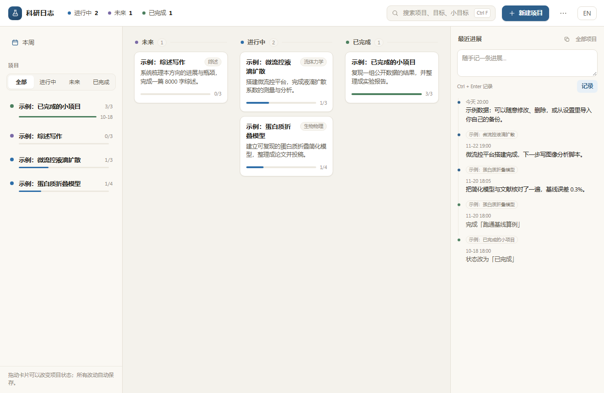
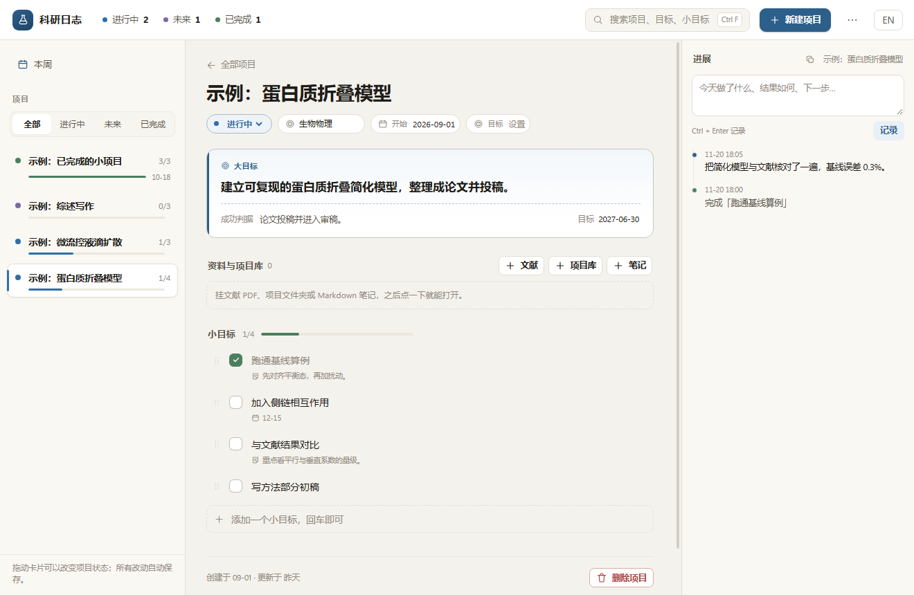
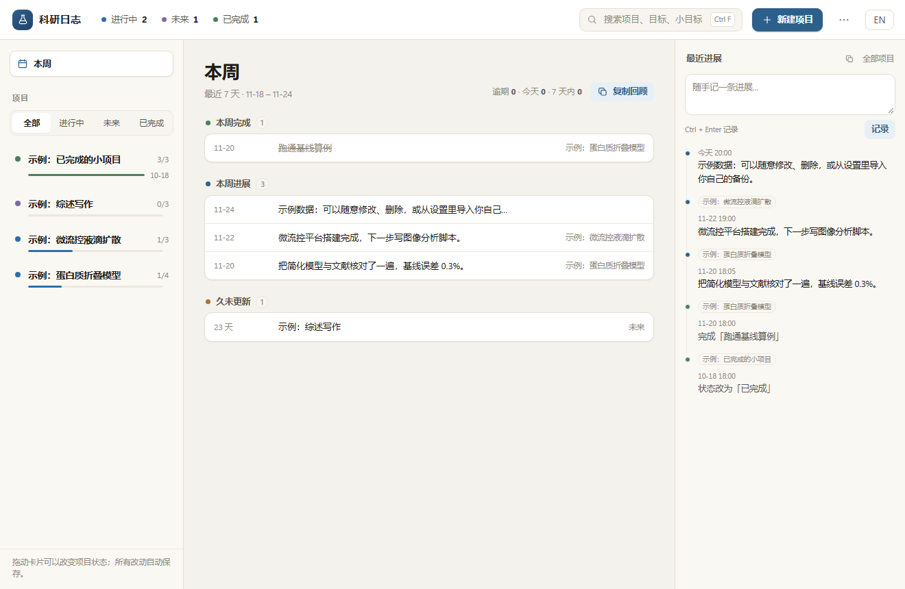
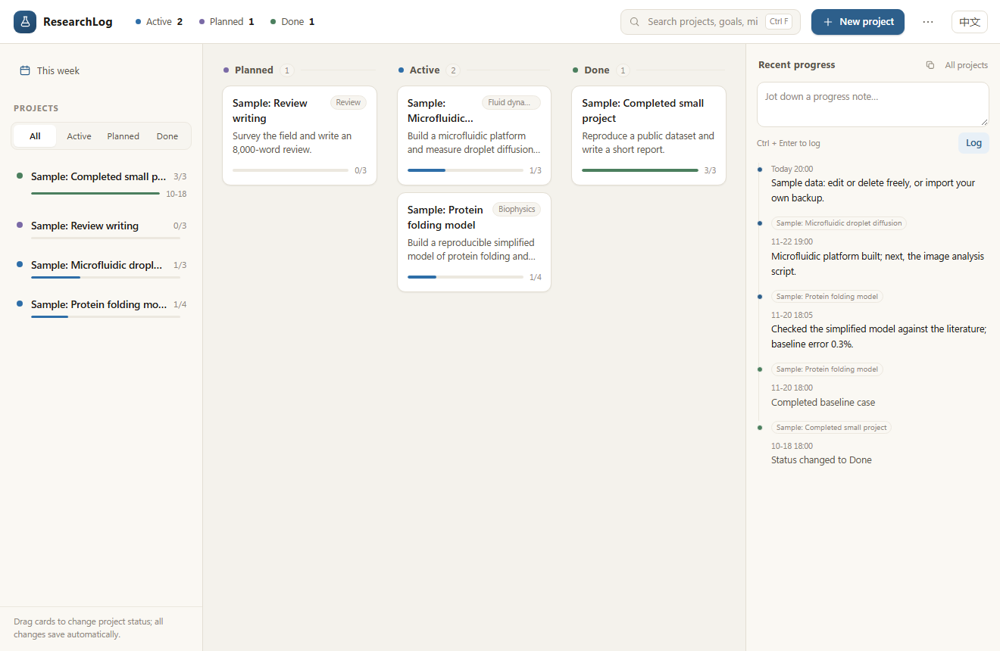
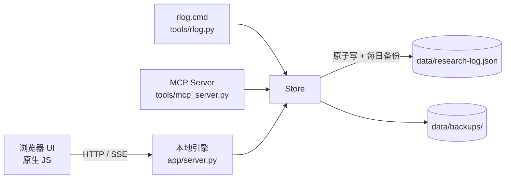

# 科研日志 · ResearchLog

[中文](README.md) | [English](README.en.md)

> **本地优先、AI 原生的科研项目与进展管理器。**
> 人用看板管理目标和进展，Agent 通过 MCP 读写同一份科研记忆。

[](LICENSE)
[](https://www.python.org/)
[](#快速开始)
[](#设计取舍)



---

## 为什么做它

科研进展通常散落在聊天记录、纸质笔记、几十个文件夹和脑子里。到了组会或写论文时，最费时间的往往不是研究本身，而是**回忆这周到底做了什么**。

通用笔记/待办工具能记录，却不理解"项目—大目标—小目标—进展—文献"这套科研结构，也无法让 AI 安全地读写你的科研上下文。

科研日志想把这件事做小、做本地、做给 Agent 用：

- **一个项目一个大目标**，下面是可以自由增删、勾选、拖拽排序的小目标；
- **进展日志**按时间记录，随时能翻，也能一键变成周报；
- **文献 / 项目库 / 笔记**挂在项目上，只存路径，不复制文件；
- **MCP** 把这套数据暴露给 Codex、Claude 等 Agent——说一句话，目标和进展就更新了；
- **中英文界面**：右上角一键切换，默认跟随浏览器语言；只翻译 UI，不翻译你的数据；
- **数据是一个可读的 JSON**，离线、无账号、可备份、可带走。

---

## 功能

### 项目与目标管理

- 三种状态：**未来 / 进行中 / 已完成**，看板三列，卡片可以直接拖到别的列；
- 每个项目一句**大目标**、**成功判据**和**目标日期**；
- 小目标可勾选、可设截止日期、可写备注，支持**拖拽排序**；
- 左侧项目列表按状态筛选，显示完成比例进度条；
- 顶部搜索框（`Ctrl F`）同时搜项目、大目标和小目标；
- 项目完成时自动记录时间，进度和看板即时更新。

### 文献、项目库与笔记

项目详情里的「资料与项目库」分三类，每类都可以挂多个：

| 类型 | 用途 | 打开方式 |
|---|---|---|
| **文献** | 论文 PDF、参考文件夹 | 系统默认阅读器 / 资源管理器 |
| **项目库** | 代码、数据、计算目录 | 资源管理器，直接跳到项目根目录 |
| **笔记** | Markdown 进展、推导、会议记录 | 内置阅读器 |

- 「拖入 / 选择文件夹 / 选择文件」三种添加方式，拖拽由一个独立小窗接收（浏览器拿不到本地路径，所以用原生窗口补齐）；
- **只保存绝对路径，不复制文件**；原文件移动后重新挂一次即可；
- 每个标签都有「在文件夹中显示」，路径失效时不用猜。

### 内置 Markdown + 公式阅读器

点开笔记直接在窗口里读，不跳外部程序：

- 标题、列表、任务清单、表格、代码块、引用、链接；
- `$...$` 行内公式和 `$$...$$` 块级公式，使用浏览器原生 **MathML** 排版：分数、上下标、根号、求和/积分、矩阵、希腊字母；
- 显示文件路径与更新时间，支持「在文件夹中显示」；
- `Esc` 或点遮罩关闭；
- 无需联网、无需 KaTeX、无额外依赖。

> 适用场景：把每周进展、推导草稿、实验记录写成 `progress.md`，挂到项目「笔记」里，之后打开就是排版好的全文。

### 进展日志与本周回顾

- 右侧日志按时间记录，支持按项目筛选、复制单条或整段；
- 「本周」视图汇总：**逾期 / 今天 / 未来 7 天 / 本周完成 / 本周进展 / 久未更新**；
- 点任意一条跳到对应项目并高亮小目标；
- 「复制回顾」一键生成 Markdown 周报，直接粘进组会材料或邮件。

### MCP：给 Agent 一个科研记忆

`tools/mcp_server.py` 是一个 stdio MCP Server，和 GUI、CLI 共用同一套 `Store`：

- 协议：JSON-RPC 2.0，逐行消息；stdout 只写协议，日志走 stderr；
- 客户端：Codex、Claude Desktop、Cursor 等支持 MCP 的工具；
- 安全边界：**只在本机进程间通过 stdio 通信**，不开端口、不联网、不需要账号；
- 写操作和 GUI 完全等价：原子写入、每日备份、`rev` 递增，窗口约 1 秒内自动刷新。

暴露的 12 个工具：

| 工具 | 作用 |
|---|---|
| `log_list` | 列出项目（可按状态筛选） |
| `log_show` | 查看项目详情、目标与最近进展 |
| `log_create_project` | 新建项目 |
| `log_add_milestone` | 添加小目标 |
| `log_check_milestone` | 勾选 / 取消小目标 |
| `log_delete_milestone` | 删除小目标 |
| `log_add_note` | 记录一条进展 |
| `log_set_status` | 修改项目状态 |
| `log_set_goal` | 修改大目标 / 判据 / 目标日期 |
| `log_rename_project` | 重命名项目 |
| `log_export` | 导出 Markdown / JSON |
| `log_delete_project` | 删除项目（危险操作，需显式确认） |

配置方法见 [docs/mcp.md](docs/mcp.md)。配置好后可以这样用：

> 「看一下蛋白质折叠项目，把今天跑通的基线验证记进去，并勾掉对应的小目标。」

Agent 会调用 `log_show` → `log_add_note` → `log_check_milestone`，界面里的进度条随即变化。

### CLI：可脚本化的同一份数据

`rlog.cmd` 复用同一个 `Store`，适合批处理、Git 钩子或其它 Agent：

```bat
rlog.cmd list
rlog.cmd add "蛋白质折叠" "跑通基线" --due 2026-12-01
rlog.cmd done "蛋白质折叠" "跑通基线"
rlog.cmd note "今天把简化模型调通了" --project "蛋白质折叠"
rlog.cmd export md --out weekly.md
rlog.cmd where
```

- 支持 `--json`（可写在任意位置）和 `--data <目录>`；
- 完整命令见 [docs/cli.md](docs/cli.md)。

### 本地优先与数据安全

- 数据是**一个普通 JSON 文件**：`data/research-log.json`；
- 原子写入（临时文件 + 替换），每天首次修改前自动备份，保留最近 14 天；
- 文件监听 + SSE：外部用 CLI / MCP 改完，开着的窗口约 1 秒内刷新；
- 无云端、无账号、无遥测；资源只记路径，不搬运文件；
- 导入 / 导出 JSON，导出 Markdown 项目报告与周报；
- 换电脑时把整个目录拷走即可，数据跟着程序走。

### 界面





- 右上角 **EN / 中文** 一键切换；默认跟随浏览器语言；
- 只翻译界面文案，**项目名、笔记、日志内容保持原样**，不会被机器翻译；
- 原生 JavaScript + CSS，无前端构建步骤；
- 浅色 / 深色跟随系统；
- 键盘可达（`Ctrl F` 搜索、`Esc` 关闭弹层/阅读器）。



---

## 快速开始

### 环境

- Windows 10 / 11；
- Python **3.12+**（源码运行）；
- Edge 或其它 Chromium 浏览器（用于应用窗口；没有 Edge 时自动退回默认浏览器）。

> 不需要安装任何 Python 第三方包，运行时零依赖。

### 方式一：下载 Release

1. 从 Releases 下载最新的 `ResearchLog-<version>-win64.zip`；
2. 解压到任意目录（路径尽量不要含特殊字符）；
3. 双击 `科研日志.exe`，或运行 `run.cmd`。

### 方式二：从源码运行

```bat
git clone https://github.com/Harmonicoscillator101/research-log.git
cd research-log
run.cmd
```

`run.cmd` 会依次尝试：项目内 `runtime\python\python.exe` → `py -3` → `python`，然后启动本地引擎并打开窗口。

也可以只启动引擎，自己用浏览器访问：

```bat
python app\server.py
:: 打开 http://127.0.0.1:47823/
```

### 目录结构

```
research-log/
├─ app/
│  ├─ server.py          # 本地 HTTP 引擎：静态资源、REST、SSE、资源打开
│  └─ web/               # 原生前端：index.html / app.js / styles.css / markdown.js
├─ tools/
│  ├─ rlog.py            # CLI 与 Store（原子写、备份、锁）
│  └─ mcp_server.py      # MCP stdio 服务端
├─ build/                # 两个原生小工具的 C# 源码（可选）
├─ docs/                 # 架构、数据格式、MCP、CLI、FAQ、构建
├─ examples/demo-data/   # 虚构示例数据
├─ launch.py             # 启动器：确保引擎运行 + 打开桌面窗口
├─ rlog.cmd              # CLI 入口
├─ run.cmd               # 源码启动入口
└─ config.json           # 数据目录与端口
```

---

## 接入 AI（MCP）

### Codex

编辑 `~/.codex/config.toml`：

```toml
[mcp_servers.research_log]
command = "python"
args = ["<REPO>/tools/mcp_server.py"]
startup_timeout_sec = 30
```

Windows 下如果 `python` 不在 PATH，可以写 `py`，参数加 `-3`：

```toml
command = "py"
args = ["-3", "<REPO>/tools/mcp_server.py"]
```

### Claude Desktop / 其它客户端

```json
{
  "mcpServers": {
    "research-log": {
      "command": "python",
      "args": ["<REPO>/tools/mcp_server.py"]
    }
  }
}
```

把 `<REPO>` 换成本仓库的绝对路径，重启客户端即可。详见 [docs/mcp.md](docs/mcp.md)。

---

## 架构



设计取舍：

- **Python 标准库**：HTTP、JSON、文件监听全部用 stdlib，下载即跑，不依赖 pip；
- **JSON 而不是数据库**：可读、可 diff、可直接备份；个人科研规模（几十个项目、几千条进展）足够；
- **路径而不是副本**：文献可能几个 GB，复制不可行；路径失效时用户重新挂一次；
- **三个入口一个 Store**：GUI、CLI、MCP 不会各自实现一套写入逻辑，避免版本和备份不一致。

更多见 [docs/architecture.md](docs/architecture.md) 与 [docs/data-format.md](docs/data-format.md)。

---

## 数据与隐私

- 默认数据目录：`data/`（相对程序目录），可在 `config.json` 的 `dataDir` 改成绝对路径；
- 默认端口：`47823`，只监听 `127.0.0.1`；
- `.gitignore` 已排除 `data/`、`runtime/`、`profile/`、`*.exe` 等，**不要把真实科研数据提交到仓库**；
- 仓库里的 `examples/demo-data/research-log.json` 是虚构示例，可安全用于演示与测试。

---

## 路线图

- [x] 项目 / 小目标 / 进展日志 / 本周回顾
- [x] 文献、项目库、笔记三类资源（路径引用 + 拖拽小窗）
- [x] 内置 Markdown + LaTeX（MathML）阅读器
- [x] CLI 与 MCP 共用 Store
- [x] 原子写、每日备份、文件监听 + SSE
- [ ] 一键生成 MCP 客户端配置
- [ ] MCP Resources / Prompts（本周回顾、项目摘要）
- [ ] 跨项目文献库
- [ ] 提醒与日历集成
- [ ] 自动化测试与打包流水线

更多见 [docs/roadmap.md](docs/roadmap.md)。

---

## 参与贡献

欢迎 Issue 和 PR。开始之前请读 [CONTRIBUTING.md](CONTRIBUTING.md)；行为准则见 [CODE_OF_CONDUCT.md](CODE_OF_CONDUCT.md)；安全问题请按 [SECURITY.md](SECURITY.md) 私下报告。

如果这个项目对你有帮助，欢迎点一个 Star。

---

## 许可证

[MIT](LICENSE)。Copyright (c) 2026 Ziyue Wang。
