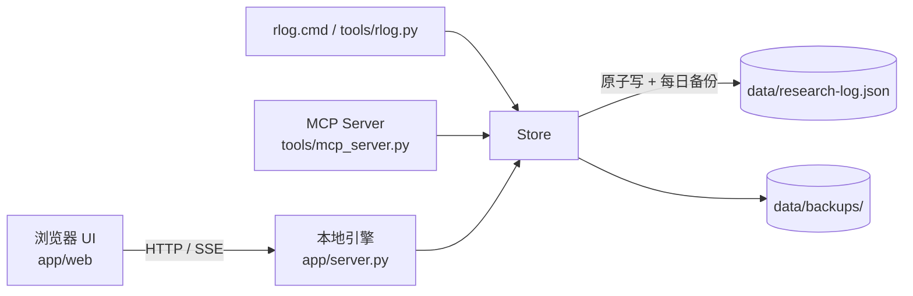

# 架构

[English](en/architecture.md) | 简体中文

科研日志是一个**单机、本地优先**的桌面工具。它没有云端、没有数据库、没有前端构建链，核心目标是用最小的运行面，把"人"和"Agent"接到同一份科研数据上。

## 总览

- **Store**（`tools/rlog.py`）是唯一的数据写入层：读取、校验、补默认字段、原子替换、备份、递增 `rev`、文件锁。
- **HTTP 引擎**（`app/server.py`）把 Store 暴露为 REST + SSE，并托管静态前端。
- **CLI**（`tools/rlog.py`）直接调用 Store，不经过 HTTP。
- **MCP Server**（`tools/mcp_server.py`）也直接调用 Store，通过 stdio 与客户端通信。

三个入口共享同一套写入规则，不会出现"GUI 写一套、CLI 写一套"的版本分裂。

## 进程与端口

| 进程 | 启动方式 | 说明 |
|---|---|---|
| 本地引擎 | `launch.py` 或 `python app/server.py` | 监听 `127.0.0.1:47823`，端口被占用时自动顺延 |
| 桌面窗口 | Edge `--app=http://127.0.0.1:<port>/` | 打不开 Edge 时退回系统默认浏览器 |
| MCP Server | 由 MCP 客户端按需拉起 | 一个客户端一个进程，stdio 通信 |

引擎在 `runtime.json` 写下实际端口、PID 和启动时间，启动器据此找到正在运行的实例。

## 数据流

### 读

1. 前端启动时 `GET /api/state` 拿到完整文档；
2. 之后通过 `GET /api/events`（SSE）保持连接；
3. Store 的文件监听器发现磁盘变化后，向 SSE 客户端推送新版本；
4. 前端收到事件后重新拉取状态并局部渲染。

### 写

1. 前端发 `PUT /api/state`；CLI / MCP 直接调用 Store；
2. Store 获取文件锁，重新读取当前磁盘内容（避免覆盖并发修改）；
3. 校验并补默认字段，`rev += 1`，`updatedAt` 更新；
4. 写临时文件 → `os.replace` 原子替换；
5. 每天第一次写入前，把旧文件复制到 `data/backups/`；
6. 唤醒 SSE 客户端，窗口约 1 秒内刷新。

## 目录职责

| 路径 | 职责 |
|---|---|
| `app/server.py` | HTTP 路由、静态文件、SSE、资源打开/读取、退出与看门狗 |
| `app/web/app.js` | 全部界面逻辑（看板、详情、日志、本周、资源、阅读器） |
| `app/web/i18n.js` | 中英文界面层：只翻译 UI 文案，跳过用户数据；语言偏好存 `localStorage` |
| `app/web/markdown.js` | Markdown 渲染 + TeX→MathML（无第三方依赖） |
| `app/web/styles.css` | 全部样式与主题变量 |
| `tools/rlog.py` | Store、CLI 命令、文件锁、备份、导出 |
| `tools/mcp_server.py` | MCP 协议、12 个工具、参数校验 |
| `launch.py` | 探活、启动引擎、打开窗口、失败提示 |
| `build/` | 两个原生小工具的 C# 源码（可选，不影响主程序） |

## 关键设计取舍

### 为什么用 JSON 而不是数据库

- 可读、可 diff、可直接备份、可用任何编辑器打开；
- 个人科研规模（几十个项目、几千条进展）完全够用；
- 换电脑只需拷贝目录，不需要导出/导入数据库；
- 代价是并发写入需要文件锁和"读-改-写"重试，Store 已处理。

### 为什么资源只存路径

论文和数据集动辄几百 MB 到几十 GB，复制不可行。程序只保存绝对路径，打开时校验路径是否来自当前数据文件，再交给系统默认程序。代价是原文件移动后链接失效，重新挂载即可。

### 为什么公式用 MathML

离线环境无法依赖 KaTeX/MathJax 的 CDN；打包它们的字体与 JS 又会显著增加体积。浏览器原生 MathML 覆盖了科研写作中最常见的公式（分数、上下标、根号、求和/积分、矩阵），且零依赖、可缩放、可复制。

### 为什么三个入口共用一个 Store

Agent 写入和用户点击必须产生完全相同的结果：同样的字段补全、同样的备份、同样的 `rev`。把写入集中到 Store，是保证数据不被三方写坏的前提。

## 安全边界

- HTTP 只绑定 `127.0.0.1`，没有鉴权，因为同机同用户进程本来就能读写 `data/`；
- `/api/resources/open` 等接口只接受当前数据文件中登记的 `resourceId`，不直接接受任意路径；
- 笔记阅读器只读数据中登记过的文本后缀，且有大小上限；
- MCP 走 stdio，不开端口、不联网；
- 无遥测、无自动更新、无云端账号。

## 扩展点

- **新增 MCP 工具**：在 `tools/mcp_server.py` 的 `TOOLS` 里声明 schema，并在调用分发处复用 `rlog` 的 Store 方法；
- **新增 CLI 命令**：在 `tools/rlog.py` 的 argparse 子命令里加，保持 `--json` 输出；
- **新增资源类型**：目前是 `ref | repo | note`，在 `server.py` 的 `normalize` 和前端 `CATEGORY` 里同步扩展；
- **替换窗口外壳**：`launch.py` 只负责"确保引擎在跑 + 打开 URL"，可以替换为 Electron/WebView2 而不动业务代码。
