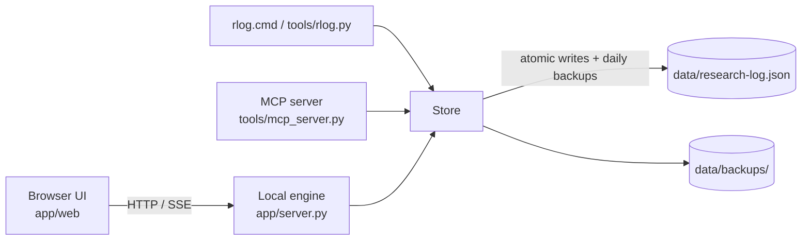

# Architecture

[简体中文](../architecture.md) | English

ResearchLog is a **single-machine, local-first** desktop tool. It has no cloud, no database, and no frontend build step. The goal is to keep the runtime surface small and let both humans and agents work on the same research data.

## Overview

- **Store** (`tools/rlog.py`) is the only write layer: validation, default fields, atomic replacement, backups, `rev` increment, and file locking.
- **HTTP engine** (`app/server.py`) exposes the Store as REST + SSE and serves the static frontend.
- **CLI** (`tools/rlog.py`) calls the Store directly, without HTTP.
- **MCP server** (`tools/mcp_server.py`) also calls the Store directly and talks to clients over stdio.

All three entry points share the same write rules, so GUI, CLI, and MCP cannot drift apart.

## Processes and ports

| Process | Started by | Notes |
|---|---|---|
| Local engine | `launch.py` or `python app/server.py` | Binds `127.0.0.1:47823`; picks the next free port if busy |
| Desktop window | Edge `--app=http://127.0.0.1:<port>/` | Falls back to the default browser if Edge is unavailable |
| MCP server | Started by the MCP client on demand | One process per client, stdio only |

The engine writes the actual port, PID, and start time to `runtime.json`; the launcher uses it to find a running instance.

## Data flow

### Read

1. The frontend calls `GET /api/state` to get the full document;
2. It subscribes to `GET /api/events` (SSE);
3. When the Store's file watcher sees an on-disk change, it pushes the new revision to SSE clients;
4. The frontend reloads state and re-renders.

### Write

1. The frontend sends `PUT /api/state`; CLI / MCP call the Store directly;
2. The Store takes a file lock and re-reads the current file (to avoid overwriting concurrent changes);
3. It validates and fills defaults, increments `rev`, and updates `updatedAt`;
4. It writes a temporary file, then `os.replace` for an atomic swap;
5. Before the first write of each day, it copies the old file to `data/backups/`;
6. It notifies SSE clients; the window refreshes within about one second.

## Layout

| Path | Responsibility |
|---|---|
| `app/server.py` | HTTP routes, static files, SSE, resource open/read, shutdown and watchdog |
| `app/web/app.js` | All UI logic (board, detail, log, week, resources, reader) |
| `app/web/markdown.js` | Markdown renderer + TeX→MathML (no third-party code) |
| `app/web/i18n.js` | Chinese/English UI layer; translates UI only, never user data |
| `app/web/styles.css` | All styles and theme variables |
| `tools/rlog.py` | Store, CLI commands, file lock, backups, export |
| `tools/mcp_server.py` | MCP protocol, 12 tools, argument validation |
| `launch.py` | Health check, start engine, open window, error dialog |
| `build/` | C# sources for the two optional native helpers |

## Key decisions

### Why JSON instead of a database

- Human-readable, diffable, easy to back up, editable with any editor;
- Personal research data is small (dozens of projects, thousands of entries);
- Moving to another machine is a folder copy, not an export/import cycle;
- The cost is that concurrent writes need a file lock and read-modify-write, which the Store handles.

### Why resources store paths only

Papers and datasets are often hundreds of MB to tens of GB, so copying is not viable. The app stores absolute paths, verifies that a path belongs to the current data file, and then hands it to the system default application. If a file moves, the link breaks and the user re-attaches it.

### Why MathML for formulas

Offline environments cannot rely on a KaTeX/MathJax CDN, and bundling their fonts and JS would significantly increase size. Native browser MathML covers the most common formulas in research writing (fractions, scripts, roots, sums/integrals, matrices), with zero dependencies, scalable rendering, and copyable text.

### Why one Store for three entry points

Agent writes and user clicks must produce identical results: same defaults, same backup, same `rev`. Centralizing writes in the Store is the precondition for not corrupting data from three directions.

## Security boundaries

- HTTP binds `127.0.0.1` only; there is no authentication because processes running as the same user can already read and write `data/`;
- `/api/resources/open` and similar endpoints only accept a `resourceId` registered in the current data file, never an arbitrary path;
- The note reader only opens registered text suffixes and enforces a size limit;
- MCP uses stdio: no port, no network;
- No telemetry, no auto-update, no cloud account.

## Extension points

- **New MCP tool**: declare the schema in `tools/mcp_server.py`'s `TOOLS` and dispatch through the existing Store methods;
- **New CLI command**: add an argparse subcommand in `tools/rlog.py`, keeping `--json` output;
- **New resource category**: currently `ref | repo | note`; update `normalize` in `server.py` and `CATEGORY` in the frontend;
- **Different window shell**: `launch.py` only ensures the engine runs and opens a URL; it can be replaced with Electron/WebView2 without touching business logic.
